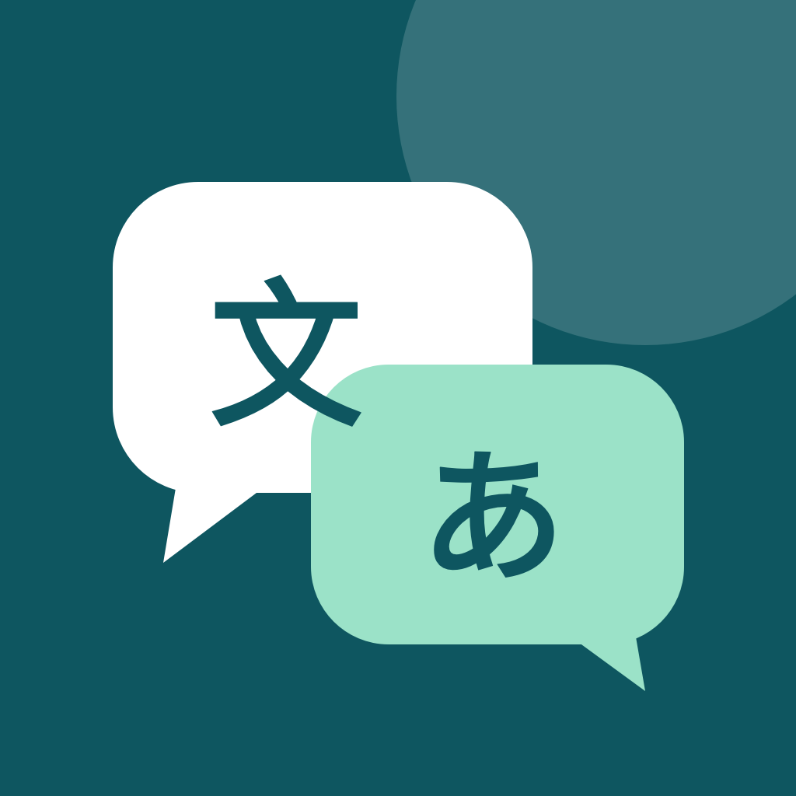

<p align="center">
  
</p>

<h1 align="center">JChat · 跨语言聊天助手</h1>

<p align="center">看懂对方的话，想好怎么回复。支持文字、聊天截图与实时语音。</p>

<p align="center">
  <a href="iOS/README.md">iPhone 安装指南</a> ·
  <a href="#网页版">网页版</a> ·
  <a href="PRIVACY.md">数据与隐私</a> ·
  <a href="CONTRIBUTING.md">参与贡献</a> ·
  <a href="LICENSE">MIT License</a>
</p>

JChat 是一个开源的双向聊天翻译工具，提供 **SwiftUI 原生 iPhone App** 和 **Python / Flask 网页版**。适合在 LINE 等聊天场景中理解外语消息、整理回复思路，再用自然的语气回应。

**Bring your own API key.** JChat is an open-source conversation translator for iPhone and the web. The iPhone app supports text, ordered chat screenshots, live speech translation, reply suggestions, and local history.

## iPhone 版能做什么

| 功能 | 用法 |
| --- | --- |
| 双向文字翻译 | 「对方说」翻成我的语言；「我要回复」翻成对方语言 |
| 最新截图翻译 | 一键读取相册最新截图，理解一整屏聊天 |
| 多图连续对话 | 一次最多选择 10 张，确认或调整顺序后统一分析 |
| 识别聊天双方 | 按 LINE 左侧对方、右侧本人分析气泡，说明双方说了什么 |
| 对话解读 | 解释聊天主题、对方意思，以及接下来可以怎样回应 |
| AI 回复建议 | 不知道回什么时点「AI建议」，获得三种可编辑、可复制的回复 |
| 语气选择 | AI 自动判断，或手动选择上级尊敬、朋友轻松、下级命令等模式 |
| 修改后重新生成 | 复制原文，或把原文带回输入框修改后重新翻译，保留旧版本 |
| 实时语音翻译 | 持续收音、本机识别、按句或停顿翻译，单次最长 60 分钟 |
| 本地翻译历史 | 自动保存，可重新打开继续回复、单独删除或全部清空 |
| 跟随系统外观 | 支持浅色／深色模式，发送后自动收起键盘 |

语言可选中文、日语、英语、韩语、法语、德语、西班牙语。可独立设置「我的语言」与「对方语言」，不要求使用者以中文为母语。

语音功能需要 **iOS 26+ 和支持 SpeechTranscriber 的设备／语言**；文字与截图功能最低支持 iOS 17。首次语音使用可能需要下载系统识别模型。语音翻译会有识别与网络延迟；到 60 分钟自动停止，收音期间保持屏幕常亮，结束后恢复原来的自动锁屏设置。

## 快速开始：iPhone

需要 Mac、可编译本项目的 Xcode（本仓库使用 Xcode 27.1 验证）、iPhone，以及你自己的 OpenAI API Key。

```sh
git clone https://github.com/iam567/JChat.git
cd JChat
open iOS/JChat.xcodeproj
```

1. 在 Xcode 中选中 **JChat → Signing & Capabilities**，选择自己的开发者 Team；必要时更改 Bundle Identifier。
2. 连接并解锁 iPhone，启用开发者模式，选择设备后运行。
3. 打开 App 右上角设置，填写自己的 OpenAI API Key，验证 Key 和模型并保存。
4. 设置自己的语言与对方语言，开始翻译。

默认模型为 `gpt-6.1-sol`，也可在设置中选择或手动输入其他兼容的 OpenAI 模型 ID。实际可用性与费用取决于个人 API 账号和所选模型。**仓库不附带共享 Key，也不是已上架 App Store 的安装包。**

完整操作、权限、构建与测试步骤见 [iPhone 版说明](iOS/README.md)。

## 典型使用流程

- **收到很长的 LINE 消息**：截图 → 导入一张或多张 → 确认顺序 → 查看翻译和对话解读。
- **知道自己想说什么**：选「我要回复」→ 输入自己的语言 → 发送 → 编辑并复制外语回复。
- **不知道怎样接话**：先导入对方消息 → 点「AI建议」→ 选择适合自己意思的回复。
- **面对面交流**：进入「语音翻译」→ 选择对方语言 → 开始收音 → 边听边看分段译文。

AI 会尝试根据上下文判断关系和语气。身份、金额、时间等重要内容仍需核对；回复建议不会自动发送到 LINE 或任何联系人。

## 网页版

仓库根目录保留轻量的 Flask 网页版，支持 Claude / OpenAI / Gemini、按聊天对象建立场景、翻译来信和生成回复建议。**上面的截图、实时语音、AI 建议和原文重新生成等新功能以原生 iPhone 版为准，两版并非功能完全相同。**

推荐 Python 3.10+，在自己的电脑上运行：

```sh
python3 -m venv .venv
source .venv/bin/activate
pip install -r requirements.txt
python app.py
```

打开 [本机网页版](http://127.0.0.1:8090)，在设置中选择提供商、填写自己的 API Key，然后创建聊天场景。网页版中列出的模型是否可用取决于提供商账号。

网页版默认只监听本机。它是单用户自托管工具，没有账号登录和访问控制；若自行部署到服务器，请先添加自己的访问控制和 HTTPS。运行时生成的 `data.json` 包含配置和聊天记录，不要提交或公开。

## 数据怎么处理

- iPhone 的 API Key 保存在本设备 Keychain，不嵌入源码，也不经作者的 VPS 转发。
- 截图会压缩后连同识别文字、最近对话发送到你配置的 OpenAI，用于辨认气泡归属和分析上下文。
- 语音由系统在手机本地识别，App 不保存原始录音，只把识别文字交给 OpenAI 翻译。
- iPhone 历史保存在 App 本地，可在 App 内删除；网页版数据保存在部署者自己的 `data.json`。

详细范围和限制见 [数据与隐私说明](PRIVACY.md)。

## 项目结构

```text
JChat/
├── iOS/
│   ├── JChat.xcodeproj/     # 原生 iPhone 工程
│   ├── JChat/              # SwiftUI、图片分析、语音与存储
│   ├── Tests/              # 无真实 API 请求的测试
│   └── README.md           # iPhone 使用与构建说明
├── app.py                  # 独立 Flask 网页版
├── templates/index.html    # 网页界面
├── requirements.txt
├── PRIVACY.md
├── CONTRIBUTING.md
└── LICENSE
```

## 验证与当前限制

模拟器和真机签名构建已通过，原生 App 已在开发者的 iPhone 安装。自动测试覆盖语言方向、上下文、回复建议、原文修正、历史兼容与删除、日语文字识别、多图请求顺序、语音断句及 60 分钟停止边界。

尚未完成连续 60 分钟收音的耐久实测。不同设备、语言和网络下的识别准确率、翻译延迟与模型表现需要实际使用验证。测试不会使用仓库内置密钥或产生真实 OpenAI 请求。

欢迎通过 [Issues](https://github.com/iam567/JChat/issues) 提交问题、通过 Pull Request 改进项目。参与前请阅读 [贡献说明](CONTRIBUTING.md)，分享示例时移除私人聊天和密钥。

## License

[MIT](LICENSE) — 可使用、修改和分发，保留许可证声明。
